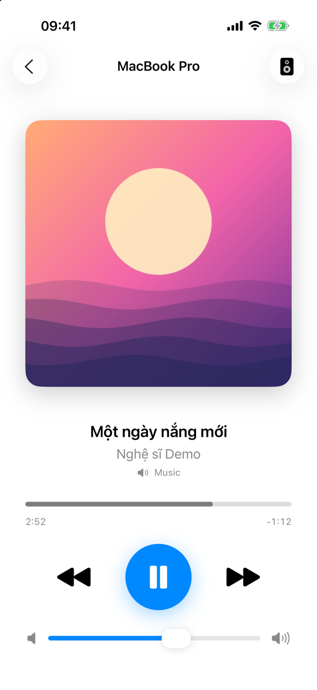
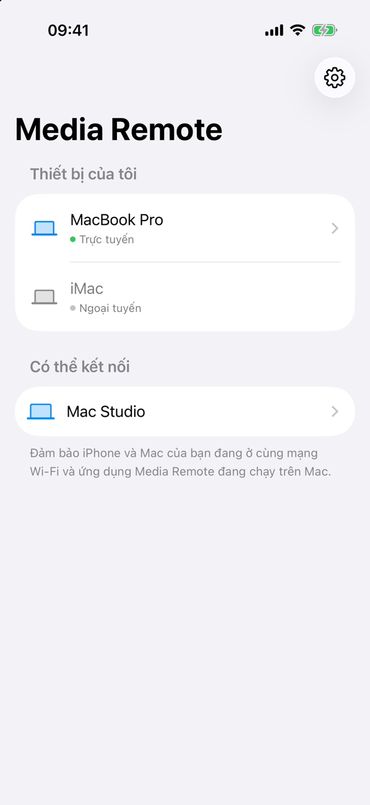
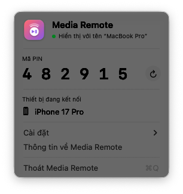
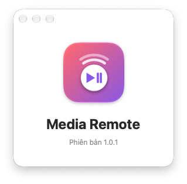

# Media Remote

Ứng dụng iPhone điều khiển việc phát nhạc/video trên Mac qua mạng LAN: play/pause, bài trước/tiếp, tua, âm lượng, chọn đầu ra âm thanh, hiển thị bài đang phát (ảnh bìa, tên bài, nghệ sĩ, tiến trình).

Gồm hai ứng dụng:

- **Mac** — ứng dụng trên thanh menu, nhận kết nối từ iPhone và điều khiển hệ thống.
- **iPhone** — tìm Mac qua Bonjour, ghép đôi bằng mã PIN 6 số, rồi điều khiển.

## Ảnh chụp

Ảnh dùng dữ liệu demo; bản sáng/tối hiển thị theo giao diện GitHub của bạn.

<p align="center">
  <picture>
    <source media="(prefers-color-scheme: dark)" srcset="docs/screenshots/ios-remote-dark.png">
    
  </picture>
  &nbsp;
  <picture>
    <source media="(prefers-color-scheme: dark)" srcset="docs/screenshots/ios-devices-dark.png">
    
  </picture>
</p>

<p align="center">
  <picture>
    <source media="(prefers-color-scheme: dark)" srcset="docs/screenshots/mac-menu-dark.png">
    
  </picture>
  &nbsp;
  <picture>
    <source media="(prefers-color-scheme: dark)" srcset="docs/screenshots/mac-about-dark.png">
    
  </picture>
</p>

## Cấu trúc

```
shared/      Giao thức dùng chung (RemoteProtocol.swift) + đóng khung JSON theo dòng trên NWConnection
mac/         MediaRemoteMac.xcodeproj
  MediaRemoteMac/      Ứng dụng thanh menu (SwiftUI + AppKit)
  MediaRemoteHelper/   dylib Objective-C đọc thông tin Now Playing (xem bên dưới)
iphone/      MediaRemote.xcodeproj — ứng dụng SwiftUI
tools/       make-icon.swift — vẽ icon cho cả hai ứng dụng
docs/        Ảnh chụp màn hình cho README
```

## Yêu cầu

- Xcode 16 trở lên (project dùng file-system synchronized groups)
- macOS 14+, iOS 17+

## Build

Mở `mac/MediaRemoteMac.xcodeproj` và `iphone/MediaRemote.xcodeproj` trong Xcode rồi Run như bình thường. Target `MediaRemoteHelper` được build và nhúng tự động vào ứng dụng Mac.

Build bằng dòng lệnh:

```sh
export DEVELOPER_DIR=/Applications/Xcode.app/Contents/Developer

xcodebuild -project mac/MediaRemoteMac.xcodeproj -scheme MediaRemoteMac build
xcodebuild -project iphone/MediaRemote.xcodeproj -scheme MediaRemote \
  -sdk iphonesimulator -destination 'generic/platform=iOS Simulator' \
  CODE_SIGNING_ALLOWED=NO build
```

Khi chụp ảnh demo, có thể đặt tên máy và mã PIN qua tham số khởi động (không ghi vào cài đặt):

```sh
open -n MediaRemoteMac.app --args -serviceName "MacBook Pro" -pairingPIN 123456
```

### Ký ứng dụng

- Bundle ID mặc định là `com.q2k.MediaRemote` và `com.q2k.MediaRemoteMac`; đổi sang ID của bạn trước khi chạy trên máy thật.
- Chọn **Team** cho target iPhone để cài lên máy. Dùng Apple ID miễn phí (Personal Team) được, nhưng ứng dụng hết hạn sau 7 ngày và không có push notification.
- Nên chọn Team cho cả `MediaRemoteMac` và `MediaRemoteHelper`. Khi ký ad-hoc, chữ ký đổi sau mỗi lần build nên macOS coi là ứng dụng mới và quyền Trợ năng bị mất.

## Quyền truy cập

- **Mạng cục bộ** — cả hai ứng dụng (Bonjour `_mediaremote._tcp`, khai báo trong `Info.plist`).
- **Trợ năng (Mac)** — chỉ cần cho đường dự phòng bằng phím media giả lập: khi MediaRemote không dùng được, hoặc khi đầu ra âm thanh không cho chỉnh âm lượng trực tiếp (HDMI/DisplayPort). Menu chỉ nhắc khi thật sự cần.

## Ghi chú kỹ thuật

- **Giao thức**: mỗi message là một dòng JSON (`RemoteMessage`). iPhone gửi `hello` kèm PIN; Mac trả `welcome` + `state`, hoặc `denied` rồi ngắt. Sau đó Mac đẩy `state` khi có thay đổi, ảnh bìa gửi riêng bằng `artwork`. Hai ứng dụng dùng chung file nên thay đổi giao thức phải giữ tương thích.
- **Now Playing**: từ macOS 15.4, MediaRemote chỉ trả thông tin cho tiến trình do Apple ký. Ứng dụng Mac chạy `/usr/bin/perl` và nạp `libMediaRemoteHelper.dylib` vào đó; helper ghi JSON ra stdout và nhận lệnh `seek` qua stdin. Đây là API riêng nên có thể hỏng ở bản macOS sau — khi đó điều khiển vẫn hoạt động, chỉ mất thông tin bài đang phát.
- **Điều khiển phát**: gửi qua `MRMediaRemoteSendCommand` (không cần quyền); phím media giả lập chỉ là dự phòng. Âm lượng và đầu ra âm thanh dùng CoreAudio.
- **Nút âm lượng iPhone**: iOS không có API chính thức. Ứng dụng theo dõi `AVAudioSession.outputVolume` và đặt lại âm lượng iPhone về giữa qua một `MPVolumeView` ẩn; âm lượng gốc được trả lại khi rời màn hình điều khiển.
- **Bảo mật**: một mã PIN dùng chung cho mọi thiết bị, lưu trong `UserDefaults`; kết nối chưa mã hoá. Đủ cho dùng trong mạng nhà, chưa phù hợp mạng công cộng.
- **Ngôn ngữ**: tiếng Anh (gốc) và tiếng Việt qua String Catalog (`Localizable.xcstrings`, `InfoPlist.xcstrings`).

## Icon

```sh
swift tools/make-icon.swift iphone/MediaRemote/Assets.xcassets/AppIcon.appiconset/AppIcon.png ios
swift tools/make-icon.swift iphone/MediaRemote/Assets.xcassets/AppIcon.appiconset/AppIcon-Dark.png ios-dark
swift tools/make-icon.swift mac/MediaRemoteMac/Assets.xcassets/AppIcon.appiconset/icon_512x512@2x.png mac
```

Các cỡ icon Mac nhỏ hơn được tạo từ bản 1024px bằng `sips -z`.
